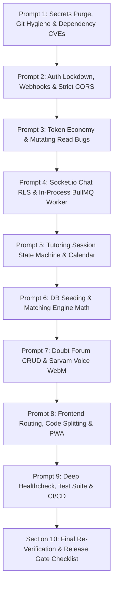

# MINDCRAFT MASTER REMEDIATION PROMPT SEQUENCE

**Document ID:** `REMEDIATION_PROMPTS.md`  
**Purpose:** Context-window-safe, copy-pasteable remediation coding prompts for an autonomous coding agent to eliminate all 115 cataloged deficiencies from `FINAL_AUDIT_REPORT.md` (6 P0 Blockers, 48 P1 High, 45 P2 Medium, 16 P3 Low).  
**Execution Mode:** Execute sequentially from Prompt 1 through Prompt 9. Do not skip prompts. After executing all prompts, run the Final Re-Verification Checklist in Section 10 to clear the production GO / NO-GO deployment gate.

---

## Remediation Sequence Overview



---

## Prompt 1: Secrets Purge, Git Hygiene & Production Dependency CVE Remediation

```markdown
ROLE: Senior Security & Systems Engineer.
MODE: EXECUTION & CODE MODIFICATION.

OBJECTIVE:
Purge tracked production credentials from git tracking, fix gitignore rules, remove unused ghost environment variables, and upgrade backend and frontend dependencies to eliminate all 72 production CVEs.

FINDING IDS ADDRESSED:
- `CRITICAL-01`: Tracked production `.env` in `frontend-react/mobile/.env`
- `MEDIUM-40`: Tracked Firebase credentials in `app/google-services.json` and commented `.gitignore` exclusion
- `HIGH-43`: Backend production CVEs (Critical IP spoofing in `proxy-addr`, High stack exhaustion in `deepmerge-ts`, misplaced `jest`/`supertest` in dependencies)
- `HIGH-44`: Frontend production CVEs (High auth bypass in `@clerk/clerk-react`, High host confusion in `fast-uri`)
- `LOW-16`: Ghost environment variable `SESSION_SECRET` in `backend/.env.example`

FILES TO MODIFY:
- `.gitignore`
- `backend/package.json`
- `frontend-react/package.json`
- `backend/.env.example`

EXECUTION INSTRUCTIONS:
1. Untrack sensitive credentials from git without deleting local files:
   - Run: `git rm --cached frontend-react/mobile/.env app/google-services.json`
   - In `.gitignore`: uncomment `app/google-services.json` (line 27) and ensure `*.env*` and `!*.env.example` prevent committing any `.env` files in any subdirectory (including `mobile/`).
2. Fix backend dependencies in `backend/package.json`:
   - Move `"jest": "^30.2.0"` and `"supertest": "^7.1.4"` from `"dependencies"` into `"devDependencies"`.
   - Upgrade `express` to `>=4.21.2` / latest patch and add `pnpm` override for `proxy-addr: ">=2.0.7"` if needed.
   - Upgrade `@prisma/client` and `prisma` to resolve `deepmerge-ts` vulnerability.
   - Run: `cd backend && pnpm install`
3. Fix frontend dependencies in `frontend-react/package.json`:
   - Upgrade `@clerk/clerk-react` to latest (`>=5.58.0`) to fix auth bypass GHSA-w24r-5266-9c3c.
   - Add pnpm `pnpm.overrides` for `"fast-uri": ">=3.1.9"`.
   - Run: `cd frontend-react && pnpm install`
4. Clean environment variable documentation:
   - Remove line 25 (`SESSION_SECRET=...`) from `backend/.env.example`.

CONSTRAINTS:
- Use `pnpm` exclusively (never `npm` or `yarn`).
- Do NOT delete the local files `frontend-react/mobile/.env` or `app/google-services.json` from the filesystem; only remove them from git index (`--cached`).
- Ensure `pnpm install` succeeds cleanly in both directories.

VERIFICATION COMMANDS:
- `git status` (confirm `frontend-react/mobile/.env` and `app/google-services.json` are staged for deletion from index)
- `cd backend && pnpm audit --prod` (confirm critical/high CVEs eliminated)
- `cd frontend-react && pnpm audit --prod` (confirm critical/high CVEs eliminated)
- `cd backend && pnpm test && cd ../frontend-react && pnpm build`
```

---

## Prompt 2: Authentication Lockdown, Webhook Security & Strict CORS

```markdown
ROLE: Senior Backend Security Architect.
MODE: EXECUTION & CODE MODIFICATION.

OBJECTIVE:
Eliminate the development authentication bypass header (`x-bypass-auth`), enforce mandatory Svix cryptographic signature verification on Clerk webhooks, and replace wildcard CORS origin reflection with an explicit, secure origin whitelist.

FINDING IDS ADDRESSED:
- `CRITICAL-02` (Part 1): Development bearer token forgery bypass in `requireAuth`
- `HIGH-03`: Header-based mock user creation permitting identity spoofing
- `HIGH-04`: Webhook secret verification bypass on misconfigured or missing secret
- `HIGH-41`: Wildcard CORS origin reflection with enabled credentials (`credentials: true`)

FILES TO MODIFY:
- `backend/src/middleware/auth.js`
- `backend/src/routes/clerkWebhook.js`
- `backend/server.js`
- `backend/src/config/socket.js`

EXECUTION INSTRUCTIONS:
1. Hardening `backend/src/middleware/auth.js`:
   - Completely remove the `x-bypass-auth` check and mock user creation block (lines 22-48).
   - Enforce that EVERY request to authenticated routes must present a valid Bearer token verified by Clerk (`@clerk/express` or Clerk JWT verify).
   - If token is missing, malformed, or invalid, return HTTP 401 with `{ success: false, error: 'Unauthorized: Invalid or missing token' }`.
   - Attach verified `req.auth = { userId: ... }` and load the associated Prisma `User` record into `req.user`. If `req.user` does not exist in DB, return HTTP 401/403.
2. Hardening `backend/src/routes/clerkWebhook.js`:
   - Check `process.env.CLERK_WEBHOOK_SIGNING_SECRET`. If not set, log an error and return HTTP 500 `{ success: false, error: 'Clerk webhook signing secret not configured' }`.
   - Require `svix-id`, `svix-timestamp`, and `svix-signature` headers. Return HTTP 400 immediately if any header is absent.
   - Verify payload strictly using `svix.Webhook(secret).verify(rawBody, headers)`. Never proceed to event handling if verification throws.
3. Hardening CORS in `backend/server.js` and `backend/src/config/socket.js`:
   - Replace the dynamic origin function in `server.js` (lines 60-76) and `socket.js` (lines 39-53).
   - Read allowed origins strictly from environment variables: `CORS_ORIGIN`, `FRONTEND_URL`, and `SOCKET_IO_CORS_ORIGIN`.
   - Never allow `allowed.includes('*')` when `credentials: true`.
   - Support a comma-separated list of valid production origins (e.g. `https://mind-craft-frontend.vercel.app`, `http://localhost:5173`). If incoming `Origin` is not in the list, reject with `new Error('CORS origin not allowed')`.

CONSTRAINTS:
- Keep all legitimate Clerk auth tokens functioning for frontend API requests.
- Ensure the Svix webhook signature verification continues passing its unit test in `backend/tests/clerkWebhook.test.js`.

VERIFICATION COMMANDS:
- `cd backend && pnpm jest tests/clerkWebhook.test.js`
- `cd backend && node -e "const auth = require('./src/middleware/auth'); console.log('Auth middleware loaded cleanly');"`
- `cd backend && pnpm test`
```

---

## Prompt 3: Token Economy Lockdown & Mutating Read Bug Elimination

```markdown
ROLE: Senior Backend Engineer & Financial Systems Auditor.
MODE: EXECUTION & CODE MODIFICATION.

OBJECTIVE:
Eliminate arbitrary caller token minting vulnerabilities, enforce caller ownership on session/forum awards, convert mutating GET endpoints into pure read-only queries, and add idempotency locking to check-ins and transactions.

FINDING IDS ADDRESSED:
- `CRITICAL-02` (Part 2): Arbitrary token minting via unguarded `POST /api/tokens/award/session` and `POST /api/tokens/award/forum`
- `CRITICAL-05`: Infinite token minting loop on HTTP GET read in `GET /api/badges/:uid`
- `CRITICAL-06`: Infinite streak bonus minting loop in `POST /api/streak/check-in`
- `HIGH-05`: Arbitrary forum token awarding without accepted answer verification
- `HIGH-21`: Non-atomic token deductions permitting race-condition overdrafts
- `HIGH-22`: Phantom freeze shield deductions on inactive days
- `HIGH-23`: 90-day hardcoded streak reset floor
- `MEDIUM-19`: Mutating auto-complete and token awards inside `GET /api/session/:uid`

FILES TO MODIFY:
- `backend/src/routes/gamification.js`
- `backend/src/services/tokenEconomy.js`
- `backend/src/services/streakService.js`
- `backend/src/routes/session.js`

EXECUTION INSTRUCTIONS:
1. Secure `backend/src/routes/gamification.js`:
   - `POST /api/tokens/award/session`: Add ownership check ensuring caller (`req.user.id` or `req.user.clerkUserId`) is a participant (`tutorId` or `learnerId`) of the referenced `sessionId` and that `session.status === 'COMPLETED'`. Reject arbitrary callers with HTTP 403.
   - `POST /api/tokens/award/forum`: Verify that caller is the author of the accepted answer in the referenced `doubtId`. Prevent double-awarding via unique idempotency key.
   - `GET /api/badges/:uid`: Strip out ALL mutating `awardTokens` and database insert/update operations. Make it a pure read-only query returning earned badges from `UserBadge` join `Badge`.
   - `POST /api/streak/check-in`: Add transaction-level idempotency key (e.g. `checkin_${userId}_${todayUTC}`). If check-in already ran today, return existing streak status without re-minting bonus tokens.
2. Fix `backend/src/routes/session.js`:
   - `GET /api/session/:uid`: Remove mutating auto-complete logic that runs on GET requests. Read operations must NEVER mutate database status or award tokens. Move auto-completion to a dedicated scheduled task or explicit `POST /api/session/:id/complete` endpoint.
3. Fix `backend/src/services/tokenEconomy.js`:
   - Wrap balance verification and `TokenTransaction` insertion in a single atomic Prisma `$transaction`. Check `user.tokenBalance >= amount` inside the transaction with row locking or conditional update (`where: { id, tokenBalance: { gte: amount } }`) to prevent concurrent overdrafts.
4. Fix `backend/src/services/streakService.js`:
   - Correct freeze shield consumption: only deduct shield if user was active on day $N-2$, inactive on $N-1$, and has shields $> 0$. Do not deduct shields for continuous dormancy.
   - Remove artificial 90-day reset floor; streak calculation must track true continuous daily activity.

CONSTRAINTS:
- All token balance changes must record an immutable `TokenTransaction` with unique `idempotencyKey`.
- Preserve existing gamification response contracts (`{ success, data: { streak, badges, balance } }`).

VERIFICATION COMMANDS:
- `cd backend && pnpm test`
- `cd backend && node -e "const token = require('./src/services/tokenEconomy'); console.log('Token economy loaded cleanly');"`
```

---

## Prompt 4: Socket.io Chat Authorization, Concurrency & In-Process BullMQ Worker Fallback

```markdown
ROLE: Senior Real-Time Systems Architect.
MODE: EXECUTION & CODE MODIFICATION.

OBJECTIVE:
Enforce strict row-level authorization on Socket.io room subscriptions, eliminate client message ID collisions, fix Redis disconnect crashes, and add an in-process BullMQ worker fallback in `server.js` so chat messages are reliably persisted to PostgreSQL on single-dyno hosting.

FINDING IDS ADDRESSED:
- `CRITICAL-03`: Socket.io chat room authorization bypass (zero RLS broadcast)
- `HIGH-06` / `HIGH-15` / `HIGH-47`: BullMQ worker hosting gap on free-tier compute causing silent chat message loss
- `HIGH-08`: Socket.io memory leak on client disconnect
- `HIGH-11`: Chat identity mismatch & broken foreign key reference in `Chat.jsx` and `chat.js`
- `HIGH-12`: Missing pagination bounds on chat history endpoint
- `HIGH-13`: Client message ID collision in socket broadcasting
- `HIGH-14`: Unhandled Redis adapter disconnect during WebSocket handshake
- `MEDIUM-39` (Part 1): Unhandled `SIGTERM`/`SIGINT` worker lifecycle in `chatPersistenceWorker.js`

FILES TO MODIFY:
- `backend/src/config/socket.js`
- `backend/src/routes/chat.js`
- `backend/src/workers/chatPersistenceWorker.js`
- `backend/server.js`

EXECUTION INSTRUCTIONS:
1. Enforce Chat Room Authorization in `backend/src/config/socket.js`:
   - In `thread:join` event listener (`socket.on('thread:join', async ({ threadId }) => ...)`), extract authenticated `socket.userId` (from Clerk socket auth).
   - Query Prisma `ChatParticipant` to verify `userId` is a member of `threadId`.
   - If NOT a participant, emit `error` (`{ message: 'Unauthorized thread access' }`) and do NOT join the socket room (`socket.join(threadId)`).
   - In `thread:leave`, cleanly leave room and clean up socket listeners.
   - In `chat:message`, generate a guaranteed server-side UUIDv4 message ID; attach sender's verified user ID; enqueue job to BullMQ `chatPersistenceQueue`; and broadcast to room.
2. Implement In-Process Worker Fallback in `backend/server.js`:
   - Inspect environment variable `RUN_IN_PROCESS_WORKERS`. If `RUN_IN_PROCESS_WORKERS === 'true'` or if `process.env.NODE_ENV === 'production'` and no standalone worker is specified, start `chatPersistenceWorker` inside `server.js`.
   - Ensure chat messages enqueued in Redis BullMQ are immediately consumed and persisted to PostgreSQL `ChatMessage` table even when running on a single dyno (Render free tier).
3. Graceful Shutdown & Worker Lifecycle in `chatPersistenceWorker.js`:
   - Add `SIGTERM` and `SIGINT` handlers that call `await worker.close()` to allow in-flight database transactions to finish cleanly before process exit.
4. Fix `backend/src/routes/chat.js`:
   - `GET /api/chat/history/:threadId`: Verify requesting user is a `ChatParticipant`. Enforce `limit = Math.min(Math.max(parseInt(limit) || 20, 1), 100)`.
   - Fix foreign key lookups: ensure user queries match on `clerkUserId` or internal UUID consistently.

CONSTRAINTS:
- Real-time latency for message broadcast must remain sub-50ms.
- Preserve existing Socket.io event names (`thread:join`, `thread:leave`, `chat:message`, `chat:message:received`).

VERIFICATION COMMANDS:
- `cd backend && pnpm test`
- `cd backend && node -e "const socket = require('./src/config/socket'); console.log('Socket config loaded cleanly');"`
```

---

## Prompt 5: Tutoring Session State Machine, Concurrency & Calendar Resilience

```markdown
ROLE: Senior Backend Engineer.
MODE: EXECUTION & CODE MODIFICATION.

OBJECTIVE:
Prevent session self-booking, eliminate state machine race conditions, enforce atomic cancellations and refunds, prevent unbounded rating multi-submissions, and make Google Calendar and .ics export resilient.

FINDING IDS ADDRESSED:
- `CRITICAL-04`: Tutoring session self-booking flaw
- `HIGH-16`: Session state machine race condition on double accept/reject
- `HIGH-17`: Missing tutor availability overlap validation
- `HIGH-18`: Non-atomic session cancellation and token refund failure
- `HIGH-19`: Unbounded session rating multi-submissions
- `HIGH-20`: Broken Google Calendar dead OAuth token refresh hanging notifications
- `MEDIUM-21`: Calendar .ics export RFC 5545 CRLF formatting bug

FILES TO MODIFY:
- `backend/src/routes/session.js`
- `backend/src/services/sessionRouter.js`
- `backend/src/services/calendarExport.js`

EXECUTION INSTRUCTIONS:
1. Fix Booking & Self-Booking in `backend/src/routes/session.js`:
   - In `POST /api/session/book`: Extract learner ID from authenticated `req.user.id`. Assert `req.user.id !== tutorId` (and `req.user.clerkUserId !== tutorClerkId`). If equal, return HTTP 400 `{ success: false, error: 'Cannot book a tutoring session with yourself' }`.
   - Validate that `startTime < endTime` and session is in the future.
   - Check tutor availability overlap against existing `CONFIRMED` or `UPCOMING` sessions.
2. Atomic State Machine Transitions in `session.js` & `sessionRouter.js`:
   - In accept/reject/cancel/complete endpoints, use conditional Prisma updates (`where: { id, status: expectedStatus }`). If updated count is 0, return HTTP 409 Conflict.
   - In cancellation: Wrap status update to `CANCELLED` and token refund in a single Prisma `$transaction`.
3. Rating Multi-Submission Guard:
   - In `POST /api/session/:id/rate`: Verify session status is `COMPLETED`.
   - Verify caller was the `learnerId` or `tutorId` and has not already rated this session. Store rating and update average tutor rating atomically.
4. Google Calendar & .ics Resilience in `calendarExport.js`:
   - Wrap Google Calendar API calls in a `try/catch` with a 5-second timeout. If Google OAuth tokens are expired or unset, log warning and gracefully fall back to returning a static Google Meet / Jitsi room link without throwing unhandled promise rejections.
   - In `.ics` calendar generation: Ensure every line break uses RFC 5545 mandatory `\r\n` (CRLF), not bare `\n`.

CONSTRAINTS:
- All session status transitions must follow: `REQUESTED` -> `UPCOMING` -> `COMPLETED` / `CANCELLED` / `REJECTED`.
- Never leave tokens in an un-refunded state on session cancellation.

VERIFICATION COMMANDS:
- `cd backend && pnpm jest tests/sessionRouter.test.js`
- `cd backend && pnpm test`
```

---

## Prompt 6: Database Seeding, Relational Integrity & Matching Engine Math

```markdown
ROLE: Principal Database Architect & Systems Engineer.
MODE: EXECUTION & CODE MODIFICATION.

OBJECTIVE:
Author a comprehensive Prisma database seed script for colleges, departments, skills, and badges; commit migration lock; fix relational cascade locks; invert matching engine math to reward complementary skills; and update deployment docs.

FINDING IDS ADDRESSED:
- `HIGH-01`: Matching engine reciprocal skill math inversion
- `HIGH-02`: Redis unhandled error crashes process in `matchingCache.js`
- `HIGH-07`: Unbounded Redis cache growth in matching engine
- `HIGH-40` / `HIGH-48`: Zero seed scripts resulting in live empty colleges/departments arrays
- `MEDIUM-36`: Missing `migration_lock.toml` in git
- `MEDIUM-37`: `Restrict` cascade hard-delete lockouts across user relations
- `MEDIUM-45`: Dangerous `prisma db push` guidance and missing backup docs in `DEPLOYMENT.md`

FILES TO MODIFY:
- `backend/prisma/seed.js` (NEW)
- `backend/prisma/schema.prisma`
- `backend/package.json`
- `backend/src/services/matchingEngine.js`
- `backend/src/services/matchingCache.js`
- `DEPLOYMENT.md`

EXECUTION INSTRUCTIONS:
1. Create `backend/prisma/seed.js`:
   - Seed at least 10 major universities/colleges (e.g. Stanford, MIT, IIT Bombay, IIT Delhi, BITS Pilani, etc.) with unique domains.
   - Seed 10 academic departments (Computer Science, Electrical Eng, Mechanical Eng, Mathematics, etc.).
   - Seed at least 30 core academic & technical skills (Data Structures, Python, Calculus, Algorithms, Organic Chemistry, etc.) categorized.
   - Seed all standard badge definitions (Weekly Warrior, 7-Day Streak, Master Tutor, etc.).
   - Make the script idempotent using `prisma.college.upsert`, `prisma.department.upsert`, `prisma.skill.upsert`, `prisma.badge.upsert`.
2. Configure Seeding in `backend/package.json`:
   - Add: `"prisma": { "seed": "node prisma/seed.js" }`
   - Add script: `"prisma:seed": "prisma db seed"`
3. Fix Prisma Relational Cascades & Migration Lock:
   - Review `schema.prisma`: for user-owned non-financial tables (`MatchRequest`, `ChatParticipant`), set appropriate cascade or soft-delete policies so account deletion does not violate restrict cascades.
   - Commit `backend/prisma/migrations/migration_lock.toml` ensuring provider is `postgresql`.
4. Fix Matching Engine Math in `backend/src/services/matchingEngine.js`:
   - Fix the reciprocal compatibility scoring formula (around lines 186-235). Users who teach what requester learns AND learn what requester teaches must receive the HIGHEST score boost. Shared skill counts must positively weight the score, not penalize it.
5. Fix Redis Cache in `backend/src/services/matchingCache.js`:
   - Add `.on('error', err => console.error('[MatchingCache Redis Error]:', err.message))` to prevent uncaught exceptions.
   - Set an explicit TTL (e.g. 300 seconds / 5 minutes) on all `setCachedFeed` calls to prevent unbounded memory growth.
6. Clean `DEPLOYMENT.md`:
   - Remove `prisma db push` as a production alternative. Enforce `pnpm prisma migrate deploy && pnpm prisma db seed`. Document Neon Point-in-Time Recovery (PITR) backup procedures.

CONSTRAINTS:
- Running `pnpm prisma db seed` must be 100% idempotent and runnable multiple times without throwing duplicate key errors.

VERIFICATION COMMANDS:
- `cd backend && pnpm prisma validate`
- `cd backend && pnpm jest tests/matchingEngine.test.js`
- `cd backend && pnpm test`
```

---

## Prompt 7: Doubt Forum End-to-End Fixes & Sarvam AI Voice Codec Support

```markdown
ROLE: Senior Full-Stack Engineer.
MODE: EXECUTION & CODE MODIFICATION.

OBJECTIVE:
Fix the `GET /trending` route collision, resolve the upvote `PATCH` vs `POST` HTTP method mismatch, sanitize markdown/HTML answers, fix browser WebM audio upload rejections in voice search, and harden Multer/Sharp image handling.

FINDING IDS ADDRESSED:
- `HIGH-10`: Missing rate limiting on voice search uploads
- `HIGH-26`: Sarvam AI unbounded retry loop on permanent 4xx errors
- `HIGH-27`: Missing Content-Type validation on doubt images
- `HIGH-28`: Unhandled Sharp image processing crashes on corrupt uploads
- `HIGH-29`: `GET /api/doubt/trending` route collision crashing with HTTP 500
- `HIGH-30`: Doubt upvote HTTP method mismatch (`PATCH` frontend vs `POST` backend returning 404)
- `HIGH-31`: Answer acceptance soft-delete discrepancy
- `HIGH-32`: Unsanitized HTML in markdown doubt answers
- `HIGH-33`: Audio WebM codec mismatch rejecting Chrome voice search (`audio/webm;codecs=opus`)
- `MEDIUM-38`: Oversized global 10MB JSON threshold

FILES TO MODIFY:
- `backend/src/routes/doubt.js`
- `frontend-react/src/services/doubtService.js`
- `frontend-react/src/pages/DoubtForum.jsx`
- `backend/src/routes/voiceSearch.js`
- `backend/src/services/sarvamAI.js`
- `backend/server.js`

EXECUTION INSTRUCTIONS:
1. Fix Route Ordering & Upvotes in `backend/src/routes/doubt.js`:
   - Move `router.get('/trending', ...)` to be mounted BEFORE `router.get('/:id', ...)`.
   - Support BOTH `router.post('/:id/upvote', ...)` AND `router.patch('/:id/upvote', ...)` so neither frontend convention fails.
   - Implement atomic upvote toggle: if user has already upvoted, remove `DoubtVote` and decrement count; if not, create `DoubtVote` and increment count.
2. Fix Frontend Service in `frontend-react/src/services/doubtService.js`:
   - Ensure `toggleUpvote` uses `POST /api/doubt/${id}/upvote` with error handling.
3. Fix Voice Search & Audio Codec in `backend/src/routes/voiceSearch.js`:
   - Update Multer file filter to accept `audio/webm`, `audio/webm;codecs=opus`, `audio/wav`, `audio/mpeg`, and `audio/ogg`.
   - Pass the audio buffer to Sarvam STT with appropriate filename extension (`.webm` or `.wav`).
4. Harden Sarvam AI Client in `backend/src/services/sarvamAI.js`:
   - Inspect HTTP error status code: do NOT retry HTTP 400, 401, 403, or 413 errors. Only retry 5xx transient server errors and network timeouts.
5. Image Upload Hardening & Body Limit in `doubt.js` & `server.js`:
   - Validate image MIME types (`image/jpeg`, `image/png`, `image/webp`). Wrap Sharp image resizing in `try/catch` to handle corrupted image files gracefully.
   - Lower global `express.json({ limit: '1mb' })` in `server.js`.
6. HTML Sanitization in `DoubtForum.jsx`:
   - Sanitize rendered markdown answers using DOMPurify or sanitize-html to prevent stored XSS attacks.

CONSTRAINTS:
- Voice search from modern browsers (Chrome, Firefox, Safari) must succeed without 415 errors.
- Forum questions, answers, and trending topics must load cleanly without UUID syntax errors.

VERIFICATION COMMANDS:
- `cd backend && pnpm jest tests/sarvamAI.test.js`
- `cd frontend-react && pnpm vitest run src/hooks/useDoubtForum.test.jsx`
- `cd backend && pnpm test && cd ../frontend-react && pnpm build`
```

---

## Prompt 8: Frontend Routing, Code Splitting, PWA & Accessibility Compliance

```markdown
ROLE: Principal Frontend Architect.
MODE: EXECUTION & CODE MODIFICATION.

OBJECTIVE:
Register missing routes (such as `/profile`), fix deep-link forum crashes, split the monolithic 1.26MB JavaScript bundle with `React.lazy()`, eliminate ineffective dynamic imports, restore viewport zoom for WCAG 1.4.4 compliance, and add semantic aria-labels.

FINDING IDS ADDRESSED:
- `HIGH-34`: Reciprocal voice matches clobbered by search state in `FindMate.jsx`
- `HIGH-35`: Missing `/profile` route in `App.jsx` dumping users on blank screen
- `HIGH-36`: Deep-link null pointer crash in `DoubtForum.jsx`
- `HIGH-37`: Disconnected pages using raw `useEffect` instead of TanStack Query
- `HIGH-38`: Monolithic 1.26MB JavaScript bundle with ineffective dynamic imports
- `HIGH-39`: Viewport zoom disabled (`user-scalable=no`) violating WCAG 1.4.4
- `LOW-01`: Ghost Three.js dependencies bloating client bundle
- `LOW-09`: Hardcoded 450 initial token balance mock in `Wallet.jsx`
- `LOW-10`: Streak detail contribution grid showing 105 cells for 35 days
- `MEDIUM-22`: Leaderboard rank -1 display and balance erasure
- `MEDIUM-31`: Missing TanStack Query mutation rollback snapshots

FILES TO MODIFY:
- `frontend-react/src/App.jsx`
- `frontend-react/src/pages/Home.jsx`
- `frontend-react/src/pages/FindMate.jsx`
- `frontend-react/src/pages/DoubtForum.jsx`
- `frontend-react/src/pages/Wallet.jsx`
- `frontend-react/src/pages/StreakDetail.jsx`
- `frontend-react/src/pages/Leaderboard.jsx`
- `frontend-react/index.html`
- `frontend-react/vite.config.js`
- `frontend-react/vercel.json`
- `frontend-react/package.json`

EXECUTION INSTRUCTIONS:
1. Routing & Crash Fixes in `frontend-react/src/App.jsx`:
   - Add `<Route path="/profile" element={<ProfileRedirect />} />` that redirects to `/profile/:currentUserId`.
   - Add a catch-all 404 route: `<Route path="*" element={<NotFound />} />`.
   - In `DoubtForum.jsx`: Guard against `doubtId` deep links where question or accepted answer is undefined. Show clean loading state or not-found banner.
2. Code Splitting & Bundle Optimization in `App.jsx` & `vite.config.js`:
   - Wrap page components (`Home`, `FindMate`, `Chat`, `DoubtForum`, `SessionsDetail`, `Profile`, `Leaderboard`, `StreakDetail`, `Notifications`, `BadgeProgress`, `Wallet`, `RatingDetail`, `MatesDetail`) in `React.lazy()` with `<Suspense fallback={<PageSpinner />}>`.
   - In `vite.config.js`: Configure manual chunking in `build.rollupOptions.output.manualChunks` (e.g. separating `vendor-react`, `vendor-clerk`, `vendor-tanstack`, `vendor-lucide`).
   - Remove unused Three.js dependencies (`three`, `@react-three/fiber`, `@react-three/drei`) from `frontend-react/package.json` if not actively rendered in 3D canvas.
   - Resolve ineffective dynamic import warning for `chatService.js`.
3. Accessibility & PWA Compliance in `frontend-react/index.html`:
   - Change line 7 viewport meta: `<meta name="viewport" content="width=device-width, initial-scale=1.0" />`. Remove `maximum-scale=1.0, user-scalable=no` to satisfy WCAG 1.4.4.
   - Add `aria-label` to all icon-only `<button>` elements in navigation bars, chat headers, and forum cards.
4. Clean Up Hardcoded Mocks:
   - In `Wallet.jsx`: Initialize balance to `0` (or `null`) and display skeleton while loading user token balance from `gamificationService.getTokens()`.
   - In `StreakDetail.jsx`: Align contribution grid dimensions to 35 activity days.
   - In `Leaderboard.jsx`: Guard against rank `-1` display; show proper unranked state.

CONSTRAINTS:
- Production bundle chunk sizes must drop below 500kB warning threshold.
- Zero broken routes; all navigation links must resolve cleanly.

VERIFICATION COMMANDS:
- `cd frontend-react && pnpm lint`
- `cd frontend-react && pnpm test`
- `cd frontend-react && pnpm build` (verify chunk size warning eliminated or significantly reduced)
```

---

## Prompt 9: SRE Deep Healthcheck, Automated Testing Suite & CI/CD Pipelines

```markdown
ROLE: Senior SRE & Principal QA Engineer.
MODE: EXECUTION & CODE MODIFICATION.

OBJECTIVE:
Install `express-rate-limit`, implement a deep database/Redis health check, fix Jest CLI coverage forwarding, install frontend coverage tooling, author comprehensive backend integration tests and frontend component tests, and configure GitHub Actions CI quality gates.

FINDING IDS ADDRESSED:
- `HIGH-42`: Complete absence of rate limiting middleware
- `HIGH-45`: Critical test void across core transactional & state transition pathways (backend 6.81% coverage)
- `HIGH-46`: Frontend test deficit & missing coverage tooling (`@vitest/coverage-v8`)
- `MEDIUM-39` (Part 2): Shallow `/health` endpoint returning static JSON without DB/Redis ping
- `MEDIUM-41`: Backend test runner CLI regex collision (`pnpm test -- --coverage`)
- `MEDIUM-42`: Complete absence of end-to-end (E2E) integration smoke suite
- `MEDIUM-43`: Missing CI/CD quality gate workflows in `.github/workflows/`
- `MEDIUM-44`: Keep-alive cron pinging shallow healthcheck

FILES TO MODIFY:
- `backend/server.js`
- `backend/package.json`
- `frontend-react/package.json`
- `backend/tests/sessionRouter.test.js`
- `backend/tests/tokenEconomy.test.js` (NEW)
- `backend/tests/health.test.js` (NEW)
- `frontend-react/src/test/DoubtForum.test.jsx` (NEW)
- `frontend-react/src/test/FindMate.test.jsx` (NEW)
- `.github/workflows/ci.yml` (NEW)

EXECUTION INSTRUCTIONS:
1. Rate Limiting & Deep Health Check in `backend/server.js`:
   - Install `express-rate-limit` in `backend/package.json`.
   - Apply global rate limiter: 100 requests per 15 minutes per IP on all routes.
   - Apply strict limiter: 10 requests per minute on `/api/voice-search` and `/api/doubt`.
   - Update `GET /health`: Execute `await prisma.$queryRaw` (SELECT 1) and `await redis.ping()`. If either fails, return HTTP 503 `{ status: 'degraded', database: ..., redis: ... }`. If healthy, return HTTP 200 `{ status: 'ok', uptime: ..., services: { postgres: 'connected', redis: 'connected' } }`.
2. Fix Test Tooling & CLI Scripts:
   - In `backend/package.json`: Add `"test:coverage": "jest --runInBand --coverage"`.
   - In `frontend-react/package.json`: Add `"@vitest/coverage-v8": "^4.0.0"` to `devDependencies`. Add `"test:coverage": "vitest run --coverage"`.
3. Expand Backend Integration & Transaction Tests:
   - Author `backend/tests/tokenEconomy.test.js`: Test atomic token balance updates, double-minting prevention via duplicate idempotency keys, and insufficient balance rejection.
   - Author `backend/tests/health.test.js`: Test `GET /health` returns 200 when DB/Redis connected, and 503 when disconnected.
   - Expand `sessionRouter.test.js`: Add tests for self-booking rejection and atomic status transitions.
4. Author Real Frontend Component Tests:
   - Author `frontend-react/src/test/DoubtForum.test.jsx`: Test forum rendering, filter tab switching, and question modal submission using React Testing Library.
   - Author `frontend-react/src/test/FindMate.test.jsx`: Test peer match card rendering and search input.
5. Create GitHub Actions CI Workflow (`.github/workflows/ci.yml`):
   - Trigger on `push` and `pull_request` to `main`.
   - Run backend job: `pnpm install`, `pnpm prisma generate`, `pnpm test`.
   - Run frontend job: `pnpm install`, `pnpm lint`, `pnpm test`, `pnpm build`.

CONSTRAINTS:
- All tests must pass reliably in local and CI environments without flakiness.
- Backend true statement coverage must increase substantially above the 6.81% baseline.

VERIFICATION COMMANDS:
- `cd backend && pnpm test:coverage`
- `cd frontend-react && pnpm lint && pnpm test && pnpm build`
- `git status` (confirm `.github/workflows/ci.yml` created)
```

---

## 10. Final Re-Verification & Live Smoke-Test Checklist

After all 9 remediation prompts have been executed, run the following verification checklist before requesting deployment authorization to re-evaluate the GO / NO-GO deployment gate:

```bash
================================================================================
MINDCRAFT FINAL GATE RE-VERIFICATION SCRIPT
================================================================================

# 1. Clean Git Hygiene & Zero Tracked Secrets
git ls-files '*.env*' '*secret*' '*serviceAccount*' 'app/google-services.json'
# MUST ONLY SHOW: backend/.env.example, frontend-react/.env.example

# 2. Production Dependency Audit
(cd backend && pnpm audit --prod)
(cd frontend-react && pnpm audit --prod)
# MUST REPORT: 0 critical vulnerabilities, 0 high vulnerabilities

# 3. Prisma Schema Validation & Seed Execution
(cd backend && pnpm prisma validate && pnpm prisma:seed)
# MUST REPORT: Schema valid, seed executed successfully

# 4. Backend Automated Test Suite & Coverage
(cd backend && pnpm test:coverage)
# MUST REPORT: All test suites passed, 0 failures

# 5. Frontend Quality Gates (Lint, Test, Build)
(cd frontend-react && pnpm lint && pnpm test && pnpm build)
# MUST REPORT: 0 lint errors, all Vitest suites passed, Vite build succeeds

# 6. Live Endpoint Smoke Checks (Post-Deployment or Staging)
curl -i -sS https://mind-craft-backend.onrender.com/health
# MUST RETURN: HTTP 200 with {"status":"ok","services":{"postgres":"connected","redis":"connected"}}

curl -i -sS https://mind-craft-backend.onrender.com/api/user/metadata/options
# MUST RETURN: HTTP 200 with non-empty colleges and departments arrays!
================================================================================
```

### Gate Re-Evaluation Criteria:
- **IF ANY STEP FAILS:** Retain **NO-GO** status; address remaining regressions.
- **IF ALL STEPS PASS:** Issue **GO** status and proceed with user-authorized production release.
